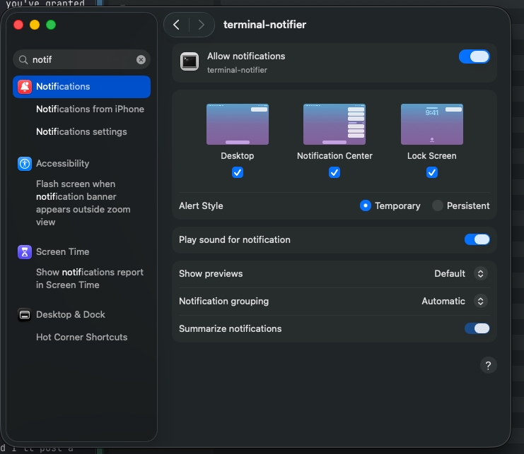

# tmux-agent-notify

Get a macOS notification when an AI agent in tmux finishes or needs you, and click it to jump straight back to the right pane.

Works with Cursor (`agent`), Claude Code (`claude`) and the OpenAI Codex CLI (`codex`).


## What you get

| When | Cursor | Claude Code | Codex |
| --- | --- | --- | --- |
| The agent needs your approval | **Cursor needs approval** | **Claude is waiting for you** | **Codex needs approval** |
| The agent asks you a question | **Cursor has a question** | **Claude is waiting for you** | not covered |
| A turn completes | **Cursor finished** | **Claude finished** | **Codex finished** |
| A turn ends with an error | **Cursor hit an error** | **Claude hit an error** | not available |

It stays out of your way:

- **No notification while you are looking at the pane.** If you switch away with a prompt still unanswered, you are notified at that moment.
- **No notification when you interrupt a turn yourself.**
- **Clicking a notification** brings your terminal forward and selects the pane.

## Install

You need macOS, tmux, and at least one of the agents above.

1. **Install the two helper tools.**

   ```bash
   brew install terminal-notifier jq
   ```

   `terminal-notifier` is what makes a click jump to your pane. `jq` already ships with macOS 15 and later.

2. **Get the code and install the hooks.**

   ```bash
   git clone https://github.com/realEbi/tmux-agent-notify.git
   cd tmux-agent-notify
   bin/install
   ```

   This sets up every agent it finds on your machine (`~/.cursor`, `~/.claude`, `~/.codex`). To pick agents yourself, name them: `bin/install claude` or `bin/install cursor codex`.

   The installer keeps your other hooks and settings, and is safe to run again.

3. **Allow notifications for terminal-notifier.** Open System Settings → Notifications → **terminal-notifier** and turn on **Allow notifications**. Choose **Persistent** if you want a notification to stay until you click it.

   

4. **Allow automation.** If macOS asks whether your terminal may control System Events, allow it. That is how the tool tells whether you are looking at the pane.

5. **Codex only: trust the hooks.** The next time you start `codex` it shows "Hooks need review". Choose **Trust all and continue**, or run `/hooks` inside Codex.

6. **Start a new agent session** inside a tmux pane, so the hooks load.

After pulling changes or moving the directory, run `bin/install` again.

## Try it

1. In a tmux pane, start your agent and ask it to run a command that needs your approval.
2. While the prompt is up, switch to another app. You should get the "waiting" notification. Claude Code sends it about six seconds after the prompt appears.
3. Approve it and stay away until the turn ends. You should get the "finished" notification.

## Troubleshooting

| Problem | What to check |
| --- | --- |
| No notification at all | The agent was started inside tmux. terminal-notifier is allowed (step 3). Focus or Do Not Disturb is off. For Codex, you trusted the hooks (step 5). |
| Clicking opens Script Editor | terminal-notifier is not installed, or not allowed to post notifications (steps 1 and 3). |
| terminal-notifier is missing from the Notifications list | Trigger one notification first so macOS registers it. If you denied it earlier, run `tccutil reset UserNotification fr.julienxx.oss.terminal-notifier` and trigger one again. |

## Good to know

- **Claude Code:** a prompt you answer within about six seconds never notifies.
- **Codex:** there is no error notification, and two sessions started in the same folder can be mixed up.
- **Locked screen:** it counts as looking, so walking away without switching app does not notify.

## Learn more

[docs/architecture.md](docs/architecture.md) explains how it works, lists the settings and every known limitation, and shows how to add another agent and run the tests.
